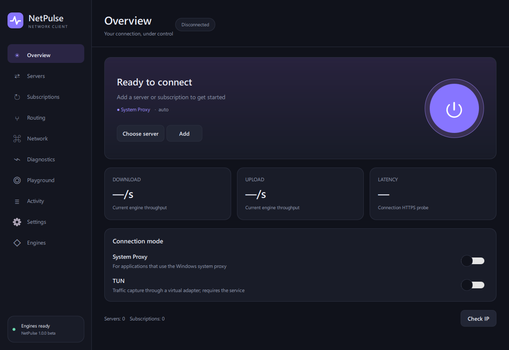

# NetPulse

**A native VPN client for Windows.**

NetPulse connects to your own servers and subscriptions. It combines a
C++ / Qt Quick desktop interface with a separate Rust network controller,
sing-box and Xray. Use System Proxy for proxy-aware applications or TUN for
traffic capture through a virtual network adapter.

**Current release: 1.0.0 beta · Windows x64**

[Download the installer](https://github.com/HACKYASHER/NetPulse/releases/download/v1.0.0-beta/NetPulse-Setup.exe)
· [Download the portable ZIP](https://github.com/HACKYASHER/NetPulse/releases/download/v1.0.0-beta/NetPulse-Portable.zip)
· [Release notes](https://github.com/HACKYASHER/NetPulse/releases/tag/v1.0.0-beta)
· [Русская инструкция](README.ru.md)



## Features

- **Server profiles and subscriptions.** Import links, configuration files and
  QR images. Refresh subscriptions manually or on a schedule. The retained
  network core supports VLESS/Reality, VMess, Trojan, Shadowsocks, SOCKS and
  supported Hysteria2/TUIC profiles.
- **System Proxy and TUN.** Configure application routing, direct exceptions,
  DNS, MTU and transport engines.
- **Separate network engines.** Bundled sing-box 1.14.3 and Xray 26.10.17 are
  verified against pinned SHA-256 hashes. Engine updates and rollback are available.
- **Diagnostics.** Test server latency, select a healthy server, run bounded
  HTTPS speed tests, analyze MTU and inspect process connection metadata.
- **Local storage.** SQLite, Windows DPAPI protection for profiles and backups,
  bounded logs, a system tray and optional Windows startup.
- **Native interface.** QML / Qt Quick, dark/light/system themes and English/Russian
  UI. No WebView2, browser or local web server is required.

NetPulse is a client: you supply the server or subscription. This project does
not include a VPN hosting service or server credentials.

## Getting started

1. Install `NetPulse-Setup.exe`, or extract the entire portable ZIP and run
   `NetPulse/NetPulse.exe`. Keep all DLLs, QML modules and `cores` together.
2. Open **Servers → Add** and import a profile or subscription.
3. Select a server. In **Overview**, enable **System Proxy** and/or **TUN**.
4. For TUN, install the service in **Network** and confirm the standard Windows
   UAC prompt. Click the power button to connect.

The tray menu provides **Disconnect** and **Quit**. Closing the window can hide
it to the tray, depending on your settings.

The application and installer are unsigned. This beta was tested with owned
local network fixtures. A full elevated TUN session through a real remote server
and physical network adapter has not been verified in this environment.
See [verification details](VERIFICATION.md).

## Data and previous versions

This edition uses `%LOCALAPPDATA%\NetPulseQt` and a separate Windows service,
`NetPulseCoreQt`. It does not automatically open or overwrite the old database.

To migrate from **3.0.4**, create a backup in the old client and restore it in
**Settings → Restore**, using the same Windows account. Restoring replaces the
Qt edition's current data. Stop the old client before connecting with this one.

[NetPulse 3.0.4](https://github.com/HACKYASHER/NetPulse/releases/tag/v3.0.4)
is retained as an **archived fallback pre-release**. The active source branch
starts with the new native desktop edition.

## Beta scope

The network controller is retained from NetPulse 3.0.4. The interface has been
rebuilt in QML. Advanced TLS, fragmentation, multiplex and routing settings
remain available through the validated JSON preferences editor; the previous
specialized editors and charts have not all been recreated.

Client self-updates from the old 3.x channel are disabled. Install future desktop
releases manually. Network engine updates remain available. Application search
displays the first 150 matching catalog entries.

## Source layout

```text
src/                            C++ application, tray and controller bridge
qml/                            QML pages and reusable controls
backend/crates/netpulse-core/    Rust network logic, storage and diagnostics
backend/crates/netpulse-host/    Private stdio controller: netpulsed.exe
backend/crates/netpulse-service/ Windows TUN service
resources/cores/                Engine manifest, licenses and runtime inputs
scripts/                        Build, packaging and verification tools
licenses/                       Third-party notices and license texts
release/                        Local build outputs, excluded from Git
```

The packaged application contains `NetPulse.exe`, `netpulsed.exe`,
`NetPulseService.exe`, Qt DLLs/plugins, QML modules and independent network engines.
See [architecture](ARCHITECTURE.md) for process and privilege boundaries.

## Building

Requirements: Windows x64, Qt 6.8.3 MSVC x64, Visual Studio 2022 C++ tools and
Windows SDK, Rust 1.88+, Python, CMake and Ninja. NSIS 3 builds the installer.
Runtime executables are release assets rather than Git source files.

Run from a **Developer PowerShell for Visual Studio**:

```powershell
python -m pip install cmake ninja py7zr
python scripts/fetch-qt.py
python scripts/fetch-cores.py
python scripts/build.py --qt .tools/Qt
python scripts/package.py
```

Alternatively, set `QTDIR` to an existing Qt SDK and `NSIS_EXE` to `makensis.exe`.
`NETPULSE_TOOLCHAIN` accepts a portable Rust/MSVC SDK; `--cargo-target` reuses a
Cargo build cache. This workspace can also reuse the neighboring project's
prepared toolchain; the application source is independent.

Outputs: `release/NetPulse/NetPulse.exe`, `release/NetPulse-Setup.exe`,
`release/NetPulse-Portable.zip` and `release/NetPulse-Source.zip`.

## Verification

```powershell
python scripts/test-ipc.py
release/NetPulse/NetPulse.exe --smoke-test C:/Temp/NetPulse-smoke
cd backend
cargo test -p netpulse-core --lib
```

The smoke run uses isolated data, renders ten pages and does not connect or
change the system proxy/TUN state. See `VERIFICATION.md` for executed checks.

## License and credits

NetPulse is **GPL-3.0-or-later**. Qt is dynamically linked under its applicable
open-source terms. Compatible DLLs can be replaced, and the client rebuilt from
the supplied sources. See [third-party components](THIRD-PARTY.md) and `licenses/`.

Developed by **HACKYASHER**, with assistance from OpenAI Codex.
