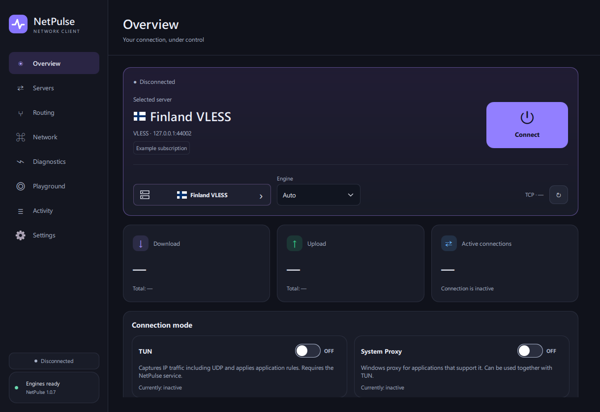

> Choose the installation folder; the client, engines, service and personal data stay under `<installation folder>`. See [installation layout and profile migration](docs/INSTALLATION.md).

# NetPulse

[<kbd>Русский</kbd>](README.ru.md)

**A native VPN client for Windows.**

NetPulse connects to your own servers and subscriptions. It combines a
C++ / Qt Quick desktop interface with a separate Rust network controller,
sing-box and Xray. Use System Proxy for proxy-aware applications or TUN for
traffic capture through a virtual network adapter.

**Current release: 1.0.9 · Windows x64**

[Download the installer](https://github.com/HACKYASHER/NetPulse/releases/download/v1.0.9/NetPulse-Setup.exe)
· [Download the portable ZIP](https://github.com/HACKYASHER/NetPulse/releases/download/v1.0.9/NetPulse-Portable.zip)
· [Release notes](https://github.com/HACKYASHER/NetPulse/releases/tag/v1.0.9)
· [Documentation](docs/README.md)



## Features

- **Overview:** country flags, transport engine selection, a connection-mode
  picker, manual latency refresh and copyable VPN/direct public IP results.
- **Servers and subscriptions:** one compact grouped list, pinned servers,
  context-menu actions, protected URLs and refresh on startup and by interval.
- **Routing:** EXE-name rules that survive application moves and updates,
  application icons, complete saved lists, JSON import/export, domain suffix
  exceptions and custom direct/proxy/block routes. New rule lists start empty.
- **Network:** separate Connection, DNS, MTU, SNI/TLS, Transport and Sniffing
  tabs. TUN Service and Engines are in Settings.
- **Diagnostics:** Proxy GET/HEAD, TCP and ICMP latency; keepalive by default;
  bounded HTTPS speed tests and persistent measurement history.
- **MTU:** presets and a sequential comparison of every value in a chosen
  range, with repeated latency/loss probes, baseline controls, restoration of
  the original setting and an explicit Apply recommendation action. The test
  changes only the owned adapter MTU, without reconnecting the VPN.
- **Playground:** grouped processes, observed sockets and engine traffic,
  per-application connection events, automatic refresh and routing controls.
- **Activity:** selectable journal/date, severity colours, copying and optional
  follow-to-latest mode, a default All view filter and access to older pages.
  Logs are kept for five days. Filtering does not restart VPN.
  Dark/light/system themes and English/Russian UI.
- **Updates and cleanup:** official verified engine updates and rollback,
  native client update checks on startup/every six hours, automatic disposal of
  managed download archives and interrupted downloads.
- **Native desktop:** C++ / Qt Quick, a Rust controller and a Windows TUN
  service. No WebView2, browser or local web server is required.

NetPulse is a client: supply your own server or subscription.

## Getting started

1. Install `NetPulse-Setup.exe`, or extract the entire portable ZIP and run
   `NetPulse/NetPulse.exe`. Keep the complete runtime folder together.
2. Open **Servers → Add connection** and import your subscription or profile.
3. Select a server. Press the power button in **Overview** and choose
   **System Proxy**, **TUN**, or both, then confirm. Service installation uses the normal Windows
   UAC dialog; the installer attempts to install it by default.
4. Configure application and domain rules in **Routing** and network settings
   in the tabs under **Network**.

The tray supports connect, disconnect, reconnect, connection modes, servers,
IP checks and navigation. The installer supports update, repair and uninstall.
Settings and subscriptions are preserved by repair and uninstall.

MTU comparison runs on the active TUN adapter without restarting the engine.
It checks each candidate with repeated latency and loss probes and restores the
original value. A recommendation requires repeatable improvement and a stable
baseline. Apply the recommendation manually. Speed Test measures throughput
separately.

Executables are unsigned. Tests use controlled network fixtures; elevated TUN
and the MTU benchmark on a physical remote VPN have not been verified here.
See [verification details](VERIFICATION.md).

## Data and previous versions

The installer keeps the client and service in the selected folder: `<installation folder>`.
Personal data lives in `data\<Windows SID>` under that root. The previous Qt
profile in `%LOCALAPPDATA%\NetPulseQt` is verified and migrated on first launch.
The service identity remains `NetPulseCoreQt`. The original 3.0.4 database is
not automatically opened or overwritten.

To migrate from **3.0.4**, create a backup in the old client and restore it in
**Settings → Restore**, using the same Windows account. Restoring replaces the
Qt edition's current data. Stop the old client before connecting with this one.

[NetPulse 3.0.4](https://github.com/HACKYASHER/NetPulse/releases/tag/v3.0.4)
is retained as an **archived fallback pre-release**. The active source branch
starts with the new native desktop edition.

## Update channel

Client updates accept the native Qt release channel marker and verified official
GitHub installer digests. The archived 3.0.4 build is excluded from this channel.
A newer installer is downloaded and run only after the user selects it.

## Source layout

```text
src/                            C++ application, tray and controller bridge
qml/                            QML pages and reusable controls
backend/crates/netpulse-core/    Rust network logic, storage and diagnostics
backend/crates/netpulse-host/    Private stdio controller: netpulsed.exe
backend/crates/netpulse-service/ Windows TUN service
resources/cores/                Engine manifest, licenses and runtime inputs
scripts/                        Build, packaging and verification tools
licenses/                       Third-party notices and license texts
release/                        Local build outputs, excluded from Git
```

The packaged application contains `NetPulse.exe`, `netpulsed.exe`,
`NetPulseService.exe`, Qt DLLs/plugins, QML modules and independent network engines.
See [architecture](ARCHITECTURE.md) for process and privilege boundaries.

## Building

Requirements: Windows x64, Qt 6.8.3 MSVC x64, Visual Studio 2022 C++ tools and
Windows SDK, Rust 1.89+, Python, CMake and Ninja. NSIS 3 builds the installer.
Runtime executables are release assets rather than Git source files.

Run from a **Developer PowerShell for Visual Studio**:

```powershell
python -m pip install cmake ninja py7zr
python scripts/fetch-qt.py
python scripts/fetch-cores.py
python scripts/fetch-engine-sources.py
python scripts/build.py --qt .tools/Qt
python scripts/package.py
```

Alternatively, set `QTDIR` to an existing Qt SDK and `NSIS_EXE` to `makensis.exe`.
`NETPULSE_TOOLCHAIN` accepts a portable Rust/MSVC SDK; `--cargo-target` reuses a
Cargo build cache.

Outputs: `release/NetPulse/NetPulse.exe`, `release/NetPulse-Setup.exe`,
`release/NetPulse-Portable.zip` and `release/NetPulse-Source.zip`.

## Verification

```powershell
python scripts/test-ipc.py
release/NetPulse/NetPulse.exe --smoke-test C:/Temp/NetPulse-smoke
cd backend
cargo test -p netpulse-core --lib
```

The smoke run renders eight sections with an isolated profile. The release
report records which checks passed and where the test environment had limits.
[Release verification](VERIFICATION.md)

## License and credits

NetPulse is **GPL-3.0-or-later**. Qt is dynamically linked under its applicable
open-source terms. Compatible DLLs can be replaced, and the client rebuilt from
the supplied sources. See [third-party components](THIRD-PARTY.md) and `licenses/`.

Developed by **HACKYASHER**, with assistance from OpenAI Codex.


Bundled engines: official Xray **26.10.31**, official sing-box **1.14.4**, unchanged from the upstream Windows release. For source builds, run `scripts/fetch-cores.py` and `scripts/fetch-engine-sources.py` before building and packaging.

[Historical engineering records](docs/README.md#historical-records)
