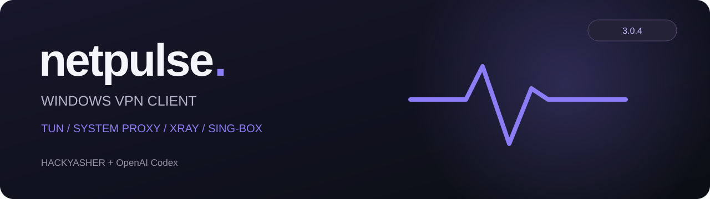

### Ваши серверы. Один Windows-клиент.

**TUN · System Proxy · Xray · sing-box**

[**Скачать NetPulse 3.0.4 для Windows x64**](https://github.com/HACKYASHER/NetPulse/releases/download/v3.0.4/NetPulse-Setup.exe) · [Релиз и portable](https://github.com/HACKYASHER/NetPulse/releases/tag/v3.0.4) · [Полный исходный код](apps/desktop-v2)

NetPulse — локальный Windows VPN-клиент для собственных серверов и подписок. Аккаунт NetPulse не требуется. Поддерживаются VLESS, Hysteria2, Trojan, Shadowsocks, SOCKS5 и HTTP CONNECT; Reality, gRPC, WebSocket и XHTTP зависят от протокола и ядра.

## Установка и обновление

1. Завершите старый NetPulse через «Выход» в трее.
2. Запустите установщик 3.0.4. Для существующей установки выберите «Обновить / восстановить»: подписки и настройки сохраняются. Также доступны удаление и выход без изменений.
3. Подтвердите обычный UAC для установки/обновления службы TUN. Интерфейс работает без прав администратора. Нужны Windows x64 и Microsoft WebView2 Runtime; установщик проверяет Runtime.

[Полный portable](https://github.com/HACKYASHER/NetPulse/releases/download/v3.0.4/NetPulse-3.0.4-windows-x64-portable.zip) содержит EXE, службу, cores/ и licenses/: сохраняйте их вместе. Службу переносной версии можно установить из раздела «Сеть». Во вложениях релиза только установщик и portable; документация, лицензии и результаты проверок находятся в репозитории. Обязательные лицензии включены также внутрь приложения.

## Изменения в 3.0.4

- Статистика читается в отдельном потоке: медленный API не удерживает блокировку команд подключения. Фоновый опрос объединён и ограничен интервалом пять секунд; последние успешные значения не превращаются в ноль при ошибке.
- Метаданные соединений ограничены размером ответа и числом сохраняемых строк. Монитор не закрывает соединения через API и не сбрасывает сеть.
- Служба повторно использует проверку маршрутов в течение секунды. Ошибка чтения не считается подтверждённым исчезновением TUN.
- При таймауте службы отображается неподтверждённое состояние; после восстановления связи устаревшее предупреждение исчезает.
- Неудачная предварительная проверка нового сервера или ядра сохраняет исходный процесс и сессию. Успешная смена по-прежнему требует переподключения.
- Сообщение ошибки проверки подключения стало коротким; ограниченные очищенные подробности доступны в журнале ядра.
- Прямой DNS предпочитает IPv4, сохраняя IPv6-only ответы. Буквальному IPv6-адресу нужен рабочий IPv6-маршрут физической сети.
- Кнопки выбора ядра компактнее; sing-box не переносится.

Подробнее: [история изменений](CHANGELOG.md), [руководство](apps/desktop-v2/README.md).

## Антивирус

Комплектные ядра проверяются по SHA-256 официальных файлов. Отдельные zapret и WinDivert64.sys в поставку не входят. Проверка целостности подтверждает происхождение файла, но не гарантирует отсутствие обнаружений: Kaspersky относит некоторые легальные сетевые инструменты к [Riskware](https://threats.kaspersky.com/en/class/Riskware/). Приложение, ядра и установщик пока не имеют подписи издателя NetPulse. Клиент не отключает защиту и не добавляет исключения.

## Исходный код

| Каталог | Содержимое |
|---|---|
| [apps/desktop-v2/ui](apps/desktop-v2/ui) | React/TypeScript интерфейс |
| [apps/desktop-v2/src-tauri](apps/desktop-v2/src-tauri) | Windows-оболочка, команды и установщик |
| [apps/desktop-v2/crates/netpulse-core](apps/desktop-v2/crates/netpulse-core) | Профили, хранение, VPN, DNS, маршрутизация и тесты |
| [apps/desktop-v2/crates/netpulse-service](apps/desktop-v2/crates/netpulse-service) | Привилегированная служба TUN |
| [scripts](scripts) | Подготовка ресурсов, тесты и сборка |
| [third-party/sources](third-party/sources) | Оригинальные соответствующие исходники зависимостей |

[Сборка на Windows](docs/BUILD-WINDOWS.md) · [Приёмка на устройстве](WINDOWS-CHECK.md) · [Контрольные суммы](checksums.sha256).

## Проверки

Прошли 136 тестов: 99 core, 4 GUI-native и 33 frontend; TypeScript/Vite, Clippy, 30 прогонов / 720 запросов маршрутизации. Проверены медленный и недоступный API статистики, обработку ответа на 10 000 строк с сохранением не более 300 подробных записей, сохранение последних значений, четыре волны по 32 TCP-соединения с неизменным PID ядра, отказ кандидата без остановки сессии и IPv6-only DNS.

Два запуска готового EXE WebView с ядрами и без них проверяют 16 разделов/окон, пояснения и геометрию. Шестиминутный тест изолированного IPC проверяет клиентов, которые перестают читать ответы.

Физический TUN, UAC, установка поверх действующей службы и разрыв конкретного провайдера не воспроизведены: установленная сеть не менялась. Браузерные тесты через localhost не запускались. Подписи издателя нет.

[Подробности](VERIFICATION.json).

## Contributors

| Участник | Вклад |
|---|---|
| [HACKYASHER](https://github.com/HACKYASHER) | Автор проекта, требования и проверка приложения |
| [OpenAI Codex](https://github.com/openai/codex) | AI-ассистент: код, исправления, тесты и подготовка сборки |

Независимый проект HACKYASHER, разработанный совместно с OpenAI Codex. Не официальный продукт OpenAI, Xray или sing-box.
